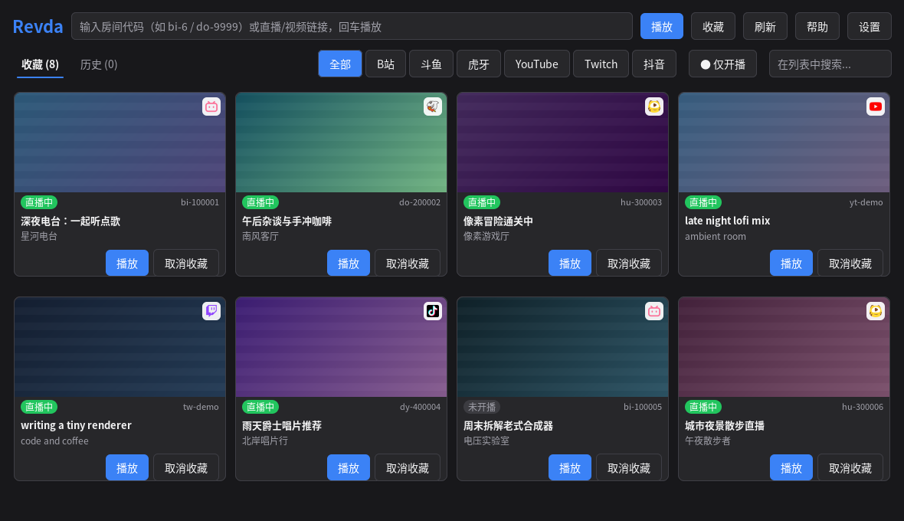
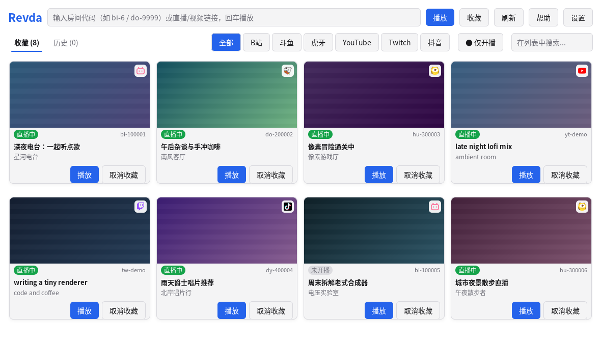
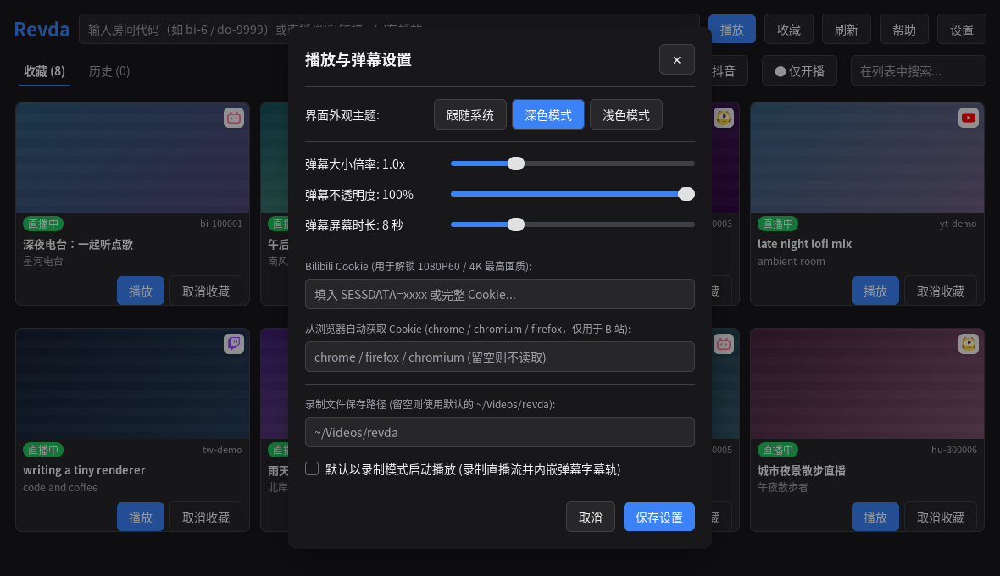
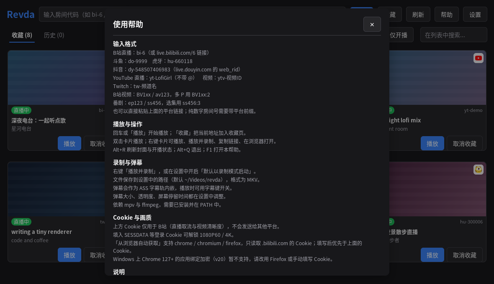

# Revda (Go 重构版)

Linux 平台下的弹幕直播与视频播放工具（基于 Go + MyGo 的全新重构版本）。

> **重构说明**：
> 本版本彻底移除了对 WebKitGTK、Node.js 及 Tauri 的依赖，采用纯 Go 语言及原生轻量 GUI 框架（MyGo）重构桌面界面，并原生实现了各大直播/视频平台的流解析与实时弹幕管线。体积更小、启动更极速，彻底告别 WebKitGTK 兼容性与渲染问题，同时无缝兼容原 dmlive 的配置体系。

## Features
* **纯 Go 原生实现**：直播流地址解析、实时弹幕 WebSocket/Tars 协议解析、ASS 弹幕实时渲染均由 Go 原生驱动。
* **极速轻量**：告别浏览器内核/WebKitGTK 依赖，秒级冷启动，内存占用大幅降低。
* **优秀播放体验**：得益于 mpv 的极致播放性能，享受稳定高帧率弹幕与无撕裂渲染。
* **音画与弹幕录制**：支持直播一键录制，自动将实时弹幕封装为内嵌字幕轨（MKV），无需后期二次压制。
* **全平台多站点覆盖**：完整支持 Bilibili 直播、普通视频与番剧（自动连播与选集），以及斗鱼、虎牙、抖音、YouTube、Twitch 等平台。
* **B 站高画质**：可手动填写 Cookie，或从 Chrome / Chromium / Firefox 自动读取 B 站登录 Cookie，解锁 1080P60 / 4K。
* **无缝兼容**：配置与收藏兼容原有配置规则（`~/.config/dmlive/config.toml`）。

## Support Status

|    Site    |   直播   |    直播弹幕    |   视频   |  视频弹幕   |
|:----------:|:----------:|:----------:|:----------:|:----------:|
| Bilibili | ✓ | ✓ | ✓ | ✓ |
| Douyu | ✓ | ✓ | |  |
| Huya | ✓ | ✓ | | |
| Douyin | ✓ | ✓ | | |
| YouTube | ✓ | ✗ | | |
| Twitch | ✓ | ✓ | | |

> YouTube 直播可正常播放（含音频），但直播弹幕暂不可用：YouTube 已变更聊天接口协议，当前的轮询实现拿不到消息。

## Screenshot

| 深色主题 | 浅色主题 |
|:---:|:---:|
|  |  |





> 截图由 MyGo 的离屏渲染测试生成（`REVDA_SCREENSHOTS=1 go test -run TestGenerateScreenshots ./internal/app`），房间与封面均为虚构数据。

## Requirements
* cmake (for build)
* [go](https://go.dev/) (>= 1.27, for build)
* [mpv](https://github.com/mpv-player/mpv)
* ffmpeg

## Installation

### Archlinux

#### [ArchlinuxCN](https://wiki.archlinux.org/index.php/Unofficial_user_repositories#archlinuxcn) repo

```
sudo pacman -S revda-git
```
Thanks for [@MarvelousBlack](https://github.com/MarvelousBlack)'s maintenance.

#### AUR
```
paru -S revda-git # or any other aur helper
```


### From source

#### 方式一：直接使用 Go 编译（推荐，极简无其他编译依赖）
```bash
git clone https://github.com/THMonster/Revda.git
cd Revda
go build -trimpath -ldflags "-s -w" -o revda main.go
./revda
```

#### 方式二：使用 CMake 安装到系统
```bash
git clone https://github.com/THMonster/Revda.git --recursive
cd Revda
mkdir build
cd build
cmake -DCMAKE_BUILD_TYPE=Release ..
# 若不需要安装纯 Go 的 dmlive 命令行：
# cmake -DCMAKE_BUILD_TYPE=Release -DNODMLIVE=1 ..
make
sudo make install/fast
```

## Usage
见[Github Wiki](https://github.com/THMonster/Revda/wiki)
